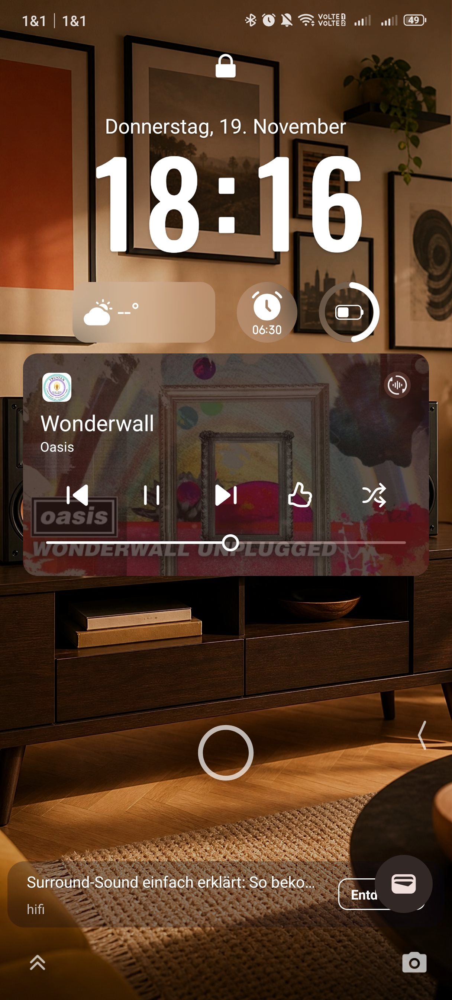
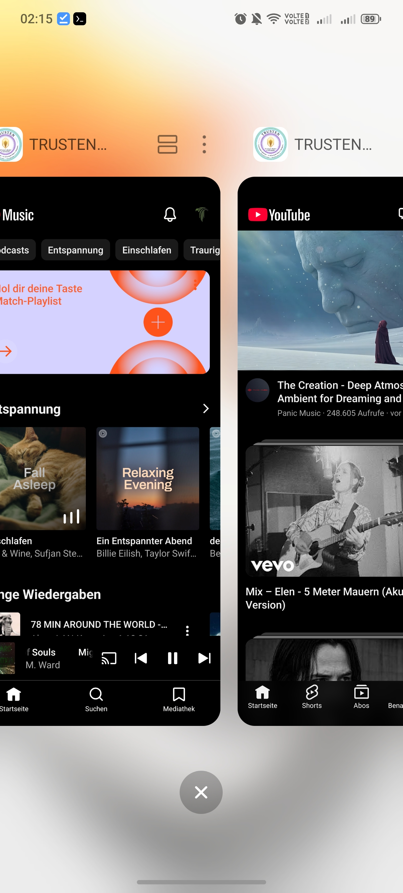

# 🔺 TRUSTENIA Δ Patches

   

**Kostenlose Open-Source-Patches für YouTube & YouTube Music (Universal SABR Buffer Fix, Custom Glass UI & Adaptive Branding)**  
*Free & Open-Source Android Patches for YouTube & YouTube Music (`arm64-v8a` / `nodpi`)*

📦 **Version:** `v2.3.0-trustenia` · ⚖️ **Lizenz:** [GPL-3.0](LICENSE) · 🤖 **Plattform:** Android

---

## 📸 Vorschau & Screenshots / Preview

| Lockscreen Player | Homescreen & Branding | Dual App & Glass UI |
| :---: | :---: | :---: |
|  |  |  |

## 📥 1-Klick Direkt-Downloads

- **Patch-Bundle (`.mpp`):** [`trustenia-patches-v2.3.0.mpp`](https://github.com/trustenapp/TRUSTENIA-patches/releases/latest/download/trustenia-patches-v2.3.0.mpp)
- **Gesamter Quellcode (`.zip`):** [`TRUSTENIA-patches-main.zip`](https://github.com/trustenapp/TRUSTENIA-patches/archive/refs/heads/main.zip)

---

- **Auto-Update Source (JSON):** [`patches-bundle.json`](https://raw.githubusercontent.com/trustenapp/TRUSTENIA-patches/main/patches-bundle.json)

## 🛠️ Vorbereitung & Voraussetzungen / Prerequisites

1. **GmsCore / microG installieren:** [ReVanced GmsCore herunterladen](https://github.com/ReVanced/GmsCore/releases/latest) *(Pflicht für Google-Login & Wiedergabe)*.
2. **Empfohlene Original-APKs (`arm64-v8a` / `nodpi`):**
   * **YouTube:** `v21.30.216`
   * **YouTube Music:** `v9.30.53`
3. **Kompatibler Patch-Manager:** Aktueller Patch-Manager (unterstützt `.mpp`-Bundles).

---

## 🇩🇪 Erste Schritte (Deutsch)

1. Lade **`trustenia-patches-v2.3.0.mpp`** über den Direkt-Download oben herunter.
2. Öffne deinen Patch-Manager, wähle unter **Patches / Quellen** die heruntergeladene `.mpp`-Datei aus.
3. Wähle deine Original-APK (**YouTube `v21.30.216`** oder **YouTube Music `v9.30.53`**).
4. Aktiviere deine gewünschten Patches (inkl. *Universal SABR Buffer Fix*, *Glass UI* & *Custom Branding*) und tippe auf **Patchen**.
5. Installiere die fertige App und melde dich über **GmsCore** an.

---

## 🇬🇧 Quick Start Guide (English)

1. Download **`trustenia-patches-v2.3.0.mpp`** using the 1-Click Direct Download link above.
2. Open your patch manager and import the `.mpp` bundle as your patch source.
3. Select your clean target APK (**YouTube `v21.30.216`** or **YouTube Music `v9.30.53`**).
4. Enable the desired patches (including *Universal SABR Buffer Fix*, *Glass UI* & *Custom Branding*) and tap **Patch**.
5. Install the patched APK and sign in via **GmsCore**.

---

## 📂 Code-Dateien & Dokumente direkt ansehen / herunterladen

| Datei / Modul | Beschreibung | Ansicht & Download |
| :--- | :--- | :--- |
| **`SabrReadaheadLimit.java`** | Universal SABR Readahead Buffer Fix (gegen Ladestopps) | [Code öffnen](https://github.com/trustenapp/TRUSTENIA-patches/tree/main/patches/src) |
| **`MusicGlassNavigationBar.java`** | Custom Glass UI & Transparenz-Effekte | [Code öffnen](https://github.com/trustenapp/TRUSTENIA-patches/tree/main/patches/src) |
| **`GlassBackdrop.java`** | Hintergrundunschärfe & Glass-Overlays | [Code öffnen](https://github.com/trustenapp/TRUSTENIA-patches/tree/main/patches/src) |
| **`ForceFullscreenLandscapePatch.java`** | Optimierte Vollbild-Steuerung | [Code öffnen](https://github.com/trustenapp/TRUSTENIA-patches/tree/main/patches/src) |
| **`MinimalMiniplayerPatch.java`** | Minimalistischer Miniplayer | [Code öffnen](https://github.com/trustenapp/TRUSTENIA-patches/tree/main/patches/src) |
| **`extensions/` & `patches/`** | Kompletter Quellcode aller Extensions & Patches | [Ordner öffnen](https://github.com/trustenapp/TRUSTENIA-patches/tree/main/patches/src) |
| **`LICENSE` & `NOTICE`** | Vollständige GPL-3.0-Lizenz & Urheberhinweise | [LICENSE](LICENSE) · [NOTICE](NOTICE) |

---

## 🔧 Selbst kompilieren / Build from Source

```bash
git clone https://github.com/trustenapp/TRUSTENIA-patches.git
cd TRUSTENIA-patches
./gradlew :patches:build
```

---

## 🌐 Community, Links & Kontakt

* **Website:** [trusten.eu](https://trusten.eu)
* **Instagram:** [@trustenia](https://instagram.com)
* **Kontakt / E-Mail:** `info@trusten.eu`
* **Fehler melden / Bug Reports:** [GitHub Issues](https://github.com/trustenapp/TRUSTENIA-patches/issues)
